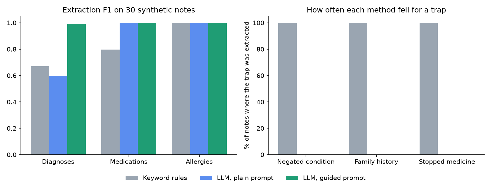

# LLM extraction from clinical notes: accuracy, traps and robustness

A small pilot experiment asking: **can an LLM reliably turn free-text clinical notes into structured data, and how can its outputs be inspected visually?**

All data is **synthetic**: 30 notes generated by `make_notes.py`, each with a stored correct answer (age, sex, diagnoses, medications with doses, allergies, smoking status). No real patient data is used. Every note contains three deliberate traps:

- a **negated** condition ("No history of asthma")
- a **family history** condition ("Mother had heart failure")
- a **stopped** medicine ("Ramipril was stopped last year due to side effects")

## Methods compared

| Method | Description |
|---|---|
| **Keyword rules** | Regex and keyword matching, no AI |
| **LLM, plain prompt** | Gemini 3.5 Flash-Lite asked to extract the fields as JSON |
| **LLM, guided prompt** | The same, plus rules on negation, family history and stopped medicines, and fixed vocabularies for names |

**Data augmentation test:** Gemini rewrote 10 notes in a hurried shorthand style (abbreviations, typos, new order) while keeping the facts. A check rejects rewrites that lose a dose or the age. The rules and the guided LLM were then run on the messy versions.

## Results



| Method | Diagnoses F1 | Medications F1 | Allergies F1 | Dose accuracy | Fell for traps (neg / family / stopped) |
|---|---|---|---|---|---|
| Keyword rules | 0.67 | 0.80 | 1.00 | 1.00 | 100% / 100% / 100% |
| LLM, plain prompt | 0.60 | 1.00 | 1.00 | 0.17 | 0% / 0% / 0% |
| LLM, guided prompt | **0.99** | **1.00** | **1.00** | **0.98** | **0% / 0% / 0%** |

On the 10 messy rewrites, the keyword rules got worse (diagnoses F1 0.64, medications 0.75, allergies 0.82), while the guided LLM scored 1.00 on all three.

**Interactive dashboard:** [view it online](https://lakshmisriniti-sys.github.io/rise-clinical-extraction-demo/results/dashboard.html), or open `results/dashboard.html` locally. It contains the charts plus a per-note error heatmap; hovering over a cell shows exactly which items a method added wrongly or missed.

## What the numbers do not show

1. **The plain LLM understood the notes; its low scores were a formatting problem.** It never fell for a trap. It lost points because it wrote names in different forms ("AFib", "OA of the knees") and put the frequency into the dose ("1000 mg twice daily"). The guided prompt's main gain came from fixing the output vocabulary and format, not from better reasoning. The scorer is strict on purpose, because inconsistent names make the data hard to aggregate and visualise.
2. **The guided LLM inferred a diagnosis that is not in the note (N12).** The patient takes levothyroxine, and the model added "hypothyroidism", although the note never states it. This is clinically plausible but it is an inference, not an extraction, which matters if the output is treated as a record of what the clinician wrote.
3. **Augmentation introduced a contradiction my check missed (N01).** The rewrite says "Nkda: codeine, penicillin", which means "no known drug allergies" followed by two allergies. My automatic check only verified doses and age, so this slipped through. LLM-generated data needs stronger validation than simple string checks.
4. The keyword baseline was written for the same templates that generated the notes, so it is favoured on the clean notes. That is why its drop on the messy rewrites is the more realistic picture.

## Limitations

- Synthetic, template-based notes are far more regular than real clinical text.
- 30 notes (10 for augmentation), one model, one run (temperature 0): a pilot, not a benchmark.
- Strict exact-match scoring; a looser scorer would rate the plain prompt higher.
- Augmented notes reuse the original answers, so any fact the rewrite changes without being caught makes the evaluation wrong.

## Possible next steps

- Validate augmented notes with a second LLM pass or a rule-based consistency check (for example "NKDA" together with listed allergies).
- Separate "stated in the note" from "inferred" in the output schema, and show the difference in the visualisation.
- Link each extracted field to the sentence it came from, so a user can check it in the dashboard.
- Test on a public de-identified or synthetic clinical dataset with more varied language.

## How to run

```bash
python -m venv .venv
.venv\Scripts\activate          # Windows
pip install -r requirements.txt
copy .env.example .env          # then paste your Gemini API key into .env
python make_notes.py            # creates data/notes.json
python run.py                   # LLM outputs are cached, so re-running resumes
python visualise.py             # results/chart.png and results/dashboard.html
```

`python fake_test.py` checks the pipeline offline with a fake model.

## Files

| File | Purpose |
|---|---|
| `make_notes.py` | Generates the synthetic notes and their correct answers |
| `extract_rules.py` | Keyword baseline |
| `extract_llm.py` | Gemini extraction (plain and guided prompts) and augmentation |
| `scoring.py` | Precision, recall, F1, dose accuracy and trap rates |
| `run.py` | Runs everything, saves `results/` |
| `visualise.py` | Static chart and interactive Plotly dashboard |

## Background

Related work: Agrawal et al., *Large language models are few-shot clinical information extractors* (EMNLP 2022).
